

  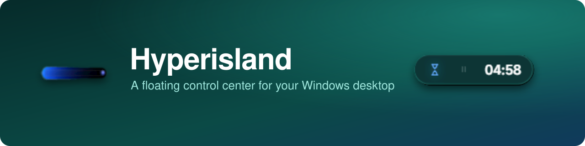

  <b>Clock ⏰ · Timer ⏳ · Media 🎵 · Clipboard 📋 · System monitor 📊 · Discord 💬 · Roblox 🎮</b> 
  Everything you want, in one small island at the top of your screen.

  <b>The <a href="https://dinoul.github.io/hyperisland.github.io/">Site.</a></b>

  
  
  
  

  <a href="#-installation">📦 Installation</a> ·
  <a href="#-modules">🧩 Modules</a> ·
  <a href="#-integrations">🔌 Integrations</a> ·
  <a href="#-customization">🎨 Customization</a> ·
  <a href="#-faq">❓ FAQ</a> ·
  <a href="../../issues">🐛 Issues</a>

---

## 📑 Table of contents

- [📖 Overview](#-overview)
- [✨ Highlights](#-highlights)
- [📸 Screenshots](#-screenshots)
- [📦 Installation](#-installation)
- [🚀 Getting started](#-getting-started)
- [🧩 Modules](#-modules)
- [🔌 Integrations](#-integrations)
- [🎨 Customization](#-customization)
- [🔒 Privacy and data](#-privacy-and-data)
- [🛠️ Troubleshooting](#-troubleshooting)
- [❓ FAQ](#-faq)
- [🐛 Reporting issues](#-reporting-issues)
- [📝 Changelog](#-changelog)
- [📄 License](#-license)

## 📖 Overview

Hyperisland is a compact, always-on-top island that lives at the top of your Windows screen. In its resting state it is a small pill showing the time, or the countdown of a running timer. Click it and it expands into the module you need, then collapses again when you are done.

It is built for people who switch constantly between windows to check the time, copy a command, start a timer, skip a track or see what is eating their RAM. Those small tasks are moved into one consistent, fast surface.

## ✨ Highlights

- 🧩 **One toolbar, eleven modules.** Clock, timer, song recognition, media player, clipboard history, notes, system monitor, task manager, Discord, Roblox and settings.
- 🪶 **Stays out of the way.** Collapsed by default, expanded only on demand.
- 🎨 **Looks native to your desktop.** Automatic light and dark behaviour, frosted glass or minimal surface, five accent colours.
- 🔄 **Keeps itself current.** Built-in update check with a visible status.
- 🔒 **Local by design.** Clipboard history and integration credentials are stored on your PC.

## 📸 Screenshots

  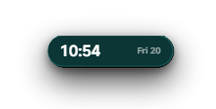

  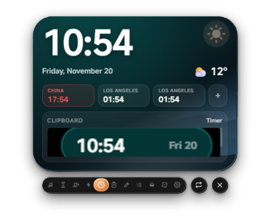
  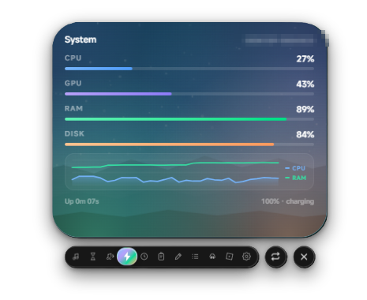
  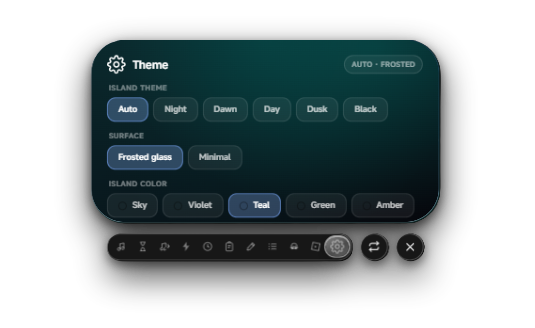

Every module is shown in detail in the <a href="#-modules">Modules</a> section.

## 📦 Installation

### Requirements

| | |
|---|---|
| 🖥️ Operating system | Windows 10 or Windows 11 |
| 🌐 Internet connection | Required for weather, song recognition and updates |
| 👤 Account | None required|

### Steps

1. Download the latest installer from the [Releases](../../releases) page.
2. Run the installer and follow the prompts.
3. Hyperisland starts and appears at the top of your screen.
4. For notification support, click allow access and click yes for the admin prompt.

### Updating

Hyperisland checks for updates in the background. The status is shown next to the toolbar, for example **Up to date · v1.0.36**. No manual action is needed.

### Uninstalling

Remove Hyperisland from **Settings → Apps → Installed apps**, like any other Windows application.

## 🚀 Getting started

1. Click the pill to expand the island.
2. Use the toolbar under it to switch modules. The highlighted icon is the active one.
3. Use the swap button on the right of the toolbar to switch the island layout, and the cross to collapse it.
4. Open the gear icon to choose a theme, a surface and an accent colour.

## 🧩 Modules

### 🕐 Clock and world time

Large local time, full date and current weather. A row of city clocks shows other time zones (the default set is China, London and New York) and the plus button adds more. A preview of recent clipboard entries is shown at the bottom of the panel.

### ⏳ Timer

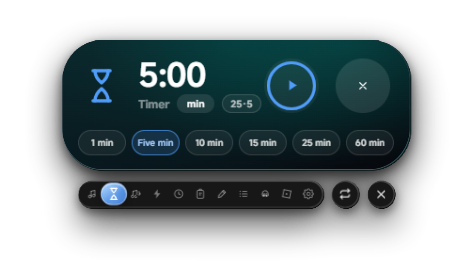

Presets for 1, 5, 10, 15, 25 and 60 minutes, a start button and a reset button. The **25·5** option runs a Pomodoro cycle of 25 minutes of focus followed by a 5 minute break.

### 🎧 Song recognition

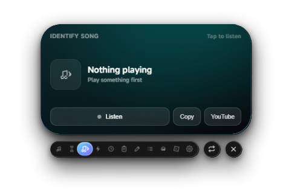

Press **Listen** while audio is playing to identify the track. When a result is found, **Copy** puts it on your clipboard and **YouTube** opens a search for it. If nothing is playing, the panel says so and asks you to start something first.

### 🎵 Media player

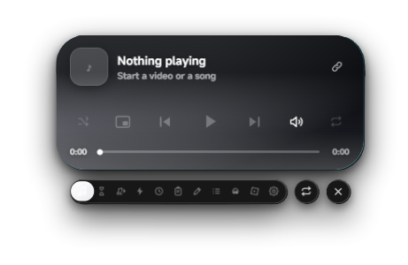

Playback controls for the active player: previous, play or pause, next, shuffle, repeat, a seek bar with elapsed and total time, volume, and a mini-player toggle. Title and artist appear once something starts playing.

### 📋 Clipboard history

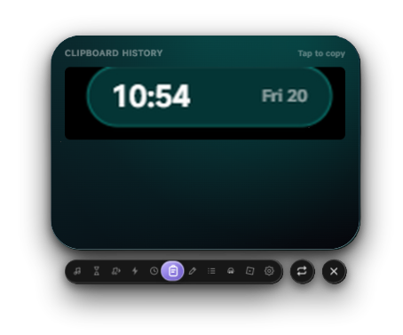

Every item you copy is listed, most recent first. Click an entry to copy it again. Useful for commands, addresses and text you paste repeatedly.

### 📊 System monitor

Live usage for CPU, GPU, RAM and disk with a combined CPU and RAM graph. The footer shows the machine name, uptime and battery or charging status.

### 📝 Notes

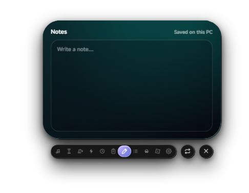

A plain text pad for quick thoughts, commands and reminders. Notes are saved on your PC, as the label in the panel header says, so they are still there the next time you open the island.

### 🗂️ Task manager

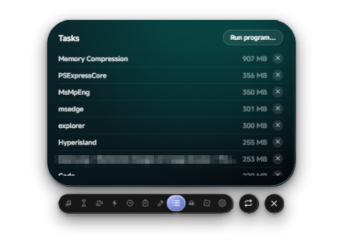

Running processes ordered by memory usage, each with its size and a close button. **Run program** launches an application or command.

### ⚙️ Settings

Theme, surface and accent colour. See Customization.

## 🔌 Integrations

### 💬 Discord

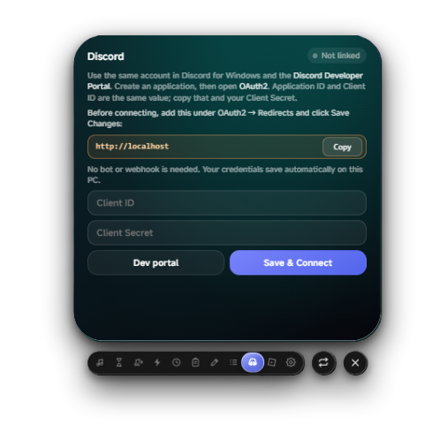

Hyperisland uses your own Discord application, so no third-party service sits between you and Discord and no bot or webhook is needed.

1. Open the [Discord Developer Portal](https://discord.com/developers/applications) and create an application. Use the same Discord account you use in Discord for Windows.
2. Go to **OAuth2 → Redirects**, add `http://localhost` and click **Save Changes**.
3. Copy the **Client ID** (it is the same value as the Application ID) and your **Client Secret**.
4. Paste both into the Discord module and click **Save & Connect**.

Credentials are saved automatically on the same PC.

### 🎮 Roblox

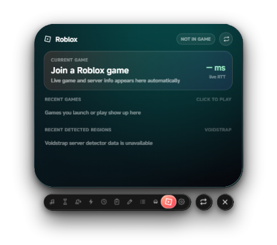

The Roblox module detects a running game automatically and shows the current game with live round-trip time. It also lists recently played games and recently detected server regions. Region information comes from Voidstrap server detection and may show as unavailable when that data cannot be read.

## 🎨 Customization

| Setting | Options |
|---|---|
| 🌗 Island theme | Auto, Night, Dawn, Day, Dusk, Black |
| 🧊 Surface | Frosted glass, Minimal |
| 🎨 Island colour | Sky, Violet, Teal, Green, Amber |

**Auto** follows your system appearance.

## 🔒 Privacy and data

| Data | Where it lives |
|---|---|
| 📋 Clipboard history | On your PC |
| 📝 Notes | On your PC |
| 🔑 Discord Client ID and Client Secret | On your PC |
| 📊 System statistics and process list | Read locally and never uploaded |
| 🌐 Weather, song recognition, updates | Require an internet connection |

## 🛠️ Troubleshooting

| Problem | What to try |
|---|---|
| Song recognition shows "Nothing playing" | Start playing audio, then press **Listen** again. |
| Weather or world clocks look stale | Check your internet connection. |
| Discord will not connect | Confirm `http://localhost` is saved under OAuth2 → Redirects and that the Client ID and Secret match the same application. |
| Roblox regions are unavailable | Region data depends on Voidstrap. The rest of the panel works without it. |
| The island is hidden | Click the area at the top of the screen where the pill normally sits. |

## ❓ FAQ

**💸 Is Hyperisland free?**
Yes.

**⚡ Does it affect performance?**
Depends on the functions running and if browser hardware acceleration is enabled.

**🐧 Does it work on macOS or Linux?**
No.

**👤 Do I need to sign in?**
Yes for discord only.

## 🐛 Reporting issues

Open an [issue](../../issues) and include:

- Hyperisland version (shown next to the toolbar)
- Windows version
- What you did, what you expected and what happened
- A screenshot if the problem is visual

## 📝 Changelog

Release notes are published on the [Releases](../../releases) page.

## 📄 License

See the `LICENSE` file in this repository.
